<picture>
  <source media="(prefers-color-scheme: dark)" srcset="./assets/header-dark.svg">
  
</picture>

 

I'm Akshay, an AI engineer in Bengaluru. I build LLM systems that people rely on at work: agents that operate inside enterprise software, document Q&A that cites its sources, and natural-language-to-SQL over large Postgres databases. I lead a 5-developer team at a US company, remote.

Most of that code is private, so this profile is the part I can share.

### Open source

<a href="https://github.com/akshayyswami/postgres-schema-mcp">
  <picture>
    <source media="(prefers-color-scheme: dark)" srcset="./assets/postgres-schema-mcp-dark.svg">
    
  </picture>
</a>

An MCP server that hands an agent only the tables relevant to its question instead of dumping the whole schema. Read-only is enforced below the prompt: a SQL AST policy that catches a DELETE hidden inside a CTE and a SELECT-only database role, with read-only transactions and a statement timeout behind them. CI runs a planted-fault matrix that has to block every unsafe query and let every safe one through.

### What I've built at work

- **An agent inside enterprise software.** It walks people through IBM TRIRIGA by driving the real web UI, live with a customer's team. Save, Submit and Delete are blocked in the tool layer, so the model can't change customer data whatever it decides.
- **AI drafting with a human at every gate.** An RFP response tool where a person approves every AI stage and every AI claim has to quote the source document or it's marked not found. Proposal turnaround went from weeks to days.
- **Plain English in, SQL out.** A natural-language-to-SQL agent that lets facilities teams ask what used to need a data scientist writing SQL.
- **Document Q&A that shows its sources.** Multi-tenant, isolated per organisation, with every answer citing where it came from.

### How I work

- Guardrails go in code, not in the prompt.
- I measure before I change things: planted-fault test matrices, CI gates, and one trace line per request so a failure can be read from the log.
- If the model can't point to the source, the answer is "not found".

### Stack

<picture>
  <source media="(prefers-color-scheme: dark)" srcset="./assets/stack-dark.svg">
  
</picture>

 

  <a href="https://akshayswami.dev"><b>akshayswami.dev</b></a> &nbsp;·&nbsp;
  <a href="https://www.linkedin.com/in/akshay-swami"><b>LinkedIn</b></a> &nbsp;·&nbsp;
  <a href="mailto:akshayram.swami@gmail.com"><b>akshayram.swami@gmail.com</b></a>

